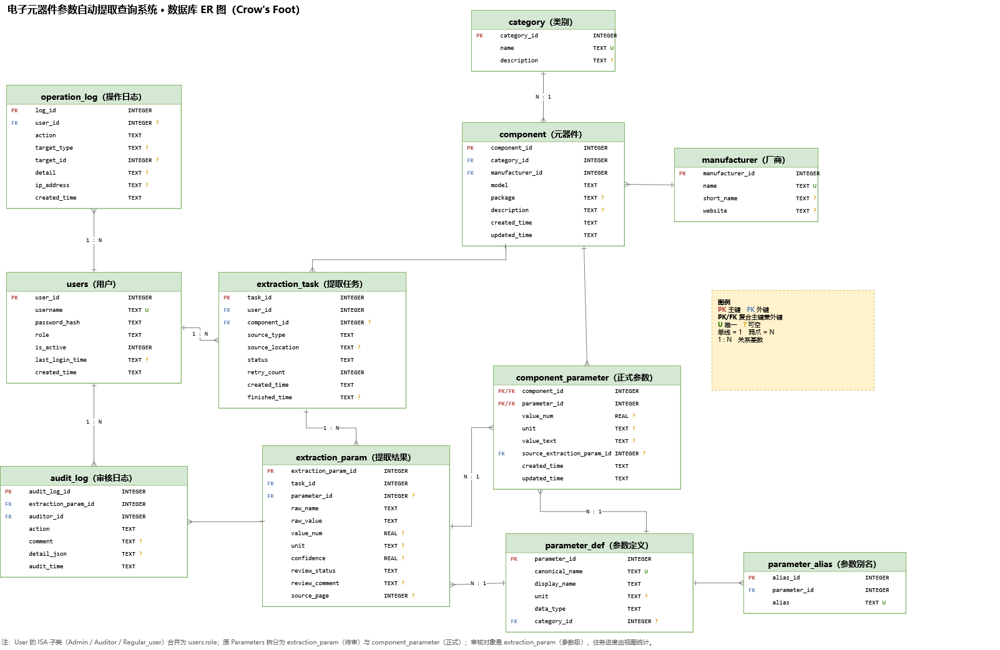

# DSC5003 电子元器件参数自动提取与管理系统

City University of Hong Kong · DSC5003 Storing and Retrieving Data · 课程小组项目（C61）。

本项目设计并实现一个面向电子元器件的参数提取与管理系统：从 PDF 数据手册、网页 URL、Excel/CSV 和手工录入中获取器件信息，经过单位归一化、参数级审核后存入关系型数据库，支持关键词搜索、参数范围筛选、多条件组合查询、多器件对比和导出。

当前仓库主要包含**数据库设计与实现**、需求规格说明书和 ER 图；Flask 后端与前端页面由小组其他成员在此基础上开发。

## 仓库结构

```text
5003_Team_Project/
├── README.md
├── .gitignore
└── Database/
    ├── db/                              # SQLite 数据库脚本与验收
    │   ├── 00_reset.sql
    │   ├── 01_schema.sql                # 表、约束、索引、视图、触发器
    │   ├── 02_seed.sql                  # 演示数据
    │   ├── 03_queries.sql               # 24 组示例查询 + 事务模板
    │   ├── 04_fts5.sql                  # 可选 FTS5 全文索引
    │   ├── init_db.py                   # 一键建库
    │   ├── verify_core.py               # 60 项核心功能验收
    │   ├── README.md                    # 数据库说明
    │   └── er_diagram/                  # ER 图生成脚本与说明
    ├── 电子元器件参数自动提取系统需求规格说明书/
    │   ├── v1.0.docx                    # 初稿
    │   └── v1.1.docx                    # 最终版（含第 2 页版本修订记录）
    ├── 数据库小组项目_v2.drawio          # 最终 ER 图（可编辑）
    ├── 数据库小组项目_v2.drawio.png      # 最终 ER 图（导出）
    ├── 数据库小组项目.drawio             # 初版 ER 图（历史）
    └── 数据库小组项目.drawio.png
```

## 数据库快速开始

要求：Python 3.8+，SQLite 3.24+（`04_fts5.sql` 需要 3.34+ 且编译了 FTS5）。

```bash
cd Database/db

# 建库 + 演示数据 + FTS5 全文索引
python init_db.py --with-fts

# 核心功能验收（只读检查 + 事务回滚，不会修改 demo.db）
python verify_core.py
```

也可以直接用 `sqlite3`：

```bash
sqlite3 demo.db < 01_schema.sql
sqlite3 demo.db < 02_seed.sql
sqlite3 -header -column demo.db < 03_queries.sql
```

`demo.db` 是生成物，不提交到仓库；运行 `init_db.py` 即可重建。

## 数据库设计要点

- **11 张表**：users、category、manufacturer、component、parameter_def、parameter_alias、extraction_task、extraction_param、component_parameter、audit_log、operation_log。
- **参数建模**：`parameter_def` 是参数字典（标准名、单位、类型），`parameter_alias` 保存同义词；`component_parameter` 用 `value_num + unit + value_text` 保存可比较、可筛选的值。
- **提取与发布分离**：`extraction_param` 是提取结果和审核对象；只有审核通过的数据才进入 `component_parameter`，并通过 `source_extraction_param_id` 指回被批准的提取结果。
- **参数级审核**：`audit_log` 指向 `extraction_param`，而不是任务；同一任务可以一部分通过、一部分驳回，任务审核进度由视图 `v_task_review` 聚合。
- **约束与触发器**：型号在厂商内唯一、单位与字典一致、审核人必须是 `role='auditor'`、审核日志只追加、审核后提取结果锁定。
- **索引**：`component_parameter(parameter_id, value_num)` 支持参数范围查询，另有审核、任务、日志等复合索引；子串搜索可用 FTS5 trigram。



## 需求文档

- 最终版：[v1.1.docx](Database/电子元器件参数自动提取系统需求规格说明书/v1.1.docx)
- 初稿：[v1.0.docx](Database/电子元器件参数自动提取系统需求规格说明书/v1.0.docx)
- 数据库脚本说明：[Database/db/README.md](Database/db/README.md)

## 小组

DSC5003 C61 · 4 人小组：

- 谷君阳
- 宋宇彤
- 邢智轩
- 王明达

## 说明

- 本项目为课程作业，未授权商用。
- 仓库不包含含个人联系方式的组队表（`TeamForming.docx`），避免公开手机号和邮箱。
- 数据库脚本在 SQLite 3.53 上完成建库、触发器测试和 60 项核心功能验收。
