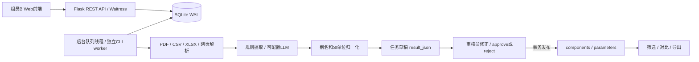

# 架构与需求实现说明

## 模块

- `backend/__init__.py`：应用工厂、配置、错误处理、CORS、CLI。
- `auth.py`：密码哈希、随机不透明Bearer Token、撤销与角色检查。
- `db.py/schema.sql`：参数化SQL、外键、索引、操作日志。
- `tasks.py/worker.py`：持久队列、原子领取、租约、重试与状态转换。
- `sources.py/extraction.py`：文件/网页边界校验、独立提取接口、大模型兼容连接器。
- `normalization.py`：标准名、数值单位和质量警告；用十进制换算防止查询边界误差。
- `audit.py`：事务性审核发布、原始/修正快照和乐观版本控制。
- `components.py/exports.py/admin.py`：正式数据访问、对比导出及管理。

## 对需求书数据库的必要补充

需求书Parameters将数值存VARCHAR，无法可靠支持数值范围和单位字段；最终实现拆成value_num/value_text/unit。保留(component_id,parameter_name)联合主键，一次发布中同名参数唯一。

需求书没有所有者、审核草稿或review_status，直接写Parameters将使未审核数据公开。实现把提取结果保存在tasks.result_json，approve才写正式表；components.owner_id实现按创建者授权。

辅助表：tokens（仅存Token SHA256）、operation_logs、component_tasks（批量发布的多对多历史）。users/manufacturers/components/tasks/parameters/audit_logs对应六个核心实体。revision/base_revision防止旧草稿覆盖新数据。

厂商+型号具有数据库唯一约束；厂商别名审批时映射到规范厂商。所有SQL值通过占位符绑定，排序字段白名单；可控identifier未直接拼入SQL。

## 事务与并发

SQLite WAL，外键每连接开启，busy_timeout=15秒。任务领取采用BEGIN IMMEDIATE，两个worker不会领取同一pending任务。处理在事务外进行，不阻塞其他查询。结果写回比较attempt与status；取消或重新领取后旧结果不能覆盖新状态。10分钟租约过期的processing任务标记failed，需显式retry。

审核同样BEGIN IMMEDIATE；参数替换、组件版本提升、关联历史、审核日志与任务状态一次提交或全部回滚。任务逻辑删除保留审计记录。组件正式删除级联参数，历史审核快照仍可追踪。

## 实现边界

高优先级主流程已实现：认证授权、多源导入、可配置提取、人工审核、元器件与参数管理、单位归一化、组合数值过滤、对比、队列状态。

低优先级未实现：保存筛选、相似元器件推荐、详情PDF导出、OCR。版本对比提供修订历史和审核原始/发布快照，没有单独图形化diff页面。后端返回差异标记，由前端高亮。网站使用条款仍由使用者按来源确认，robots检查不等于自动判定全部法律许可。

已有任务保留其源文件；删除任务为逻辑删除，不立即销毁源文件，避免审计证据丢失。课程原型没有附件保留期清理服务。上传PDF解析依赖进程内第三方库，极端畸形文件的强CPU/内存隔离需要部署层沙箱或单独进程。
